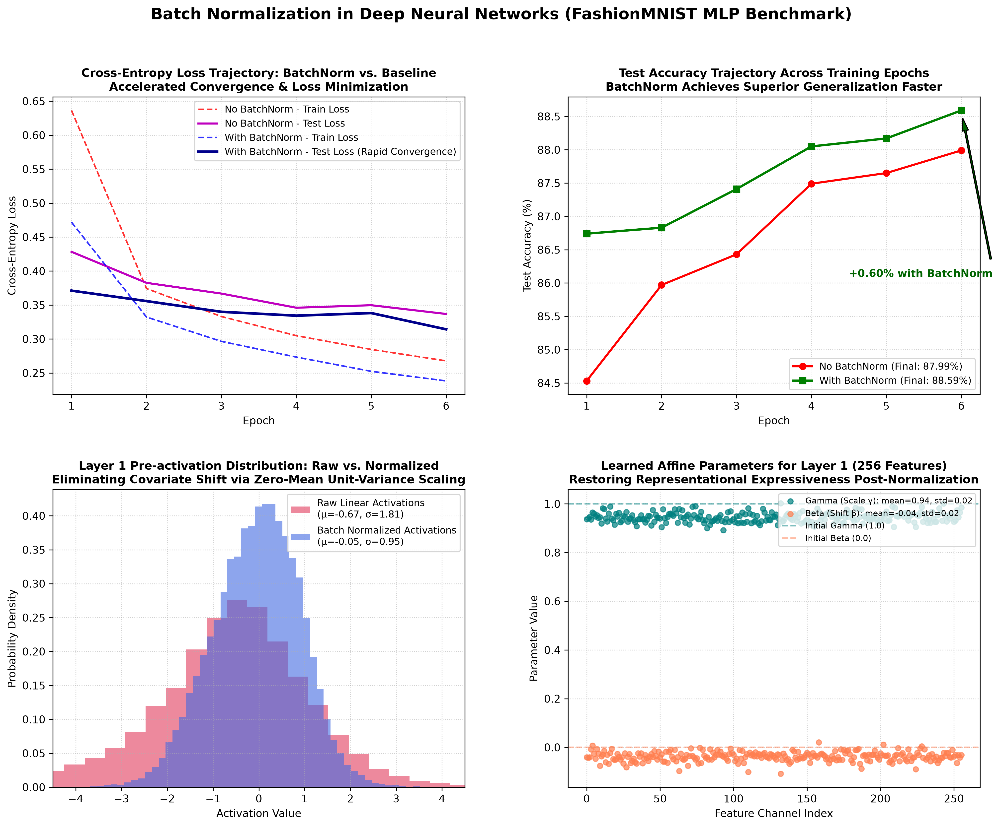

# Batch Normalization in PyTorch: Mathematical Implementation & MLP Convergence Benchmark

[](https://pytorch.org/)
[](https://opensource.org/licenses/MIT)
[](https://www.python.org/)
[]()
[]()

An end-to-end, mathematically rigorous PyTorch implementation of **Batch Normalization** (`nn.BatchNorm1d`) and a custom from-scratch module (`CustomBatchNorm1d`) based on Ioffe & Szegedy (2015).

This project features an empirical benchmark on the **FashionMNIST** benchmark ($60,000$ training images, $10,000$ test images), comparing an unnormalized Deep Multi-Layer Perceptron (MLP) against a Batch-Normalized network under an aggressive learning rate ($\eta = 0.02$). It demonstrates how batch normalization stabilizes internal covariate shift, smooths the loss landscape, accelerates early convergence, and yields superior terminal accuracy.

---

## Visual Diagnostic Overview

The 4-panel diagnostic dashboard below illustrates the complete comparative study: training/validation loss trajectories, validation accuracy acceleration, intermediate layer activation distributions (eliminating covariate shift), and the learned affine parameter distributions ($\gamma$ and $\beta$):



---

## Table of Contents

- [Visual Diagnostic Overview](#visual-diagnostic-overview)
- [Mathematical Formulation of Batch Normalization](#mathematical-formulation-of-batch-normalization)
  - [1. Mini-Batch Statistics & Normalization](#1-mini-batch-statistics--normalization)
  - [2. Affine Transformation (Scale & Shift)](#2-affine-transformation-scale--shift)
  - [3. Exponential Moving Statistics for Inference](#3-exponential-moving-statistics-for-inference)
  - [4. First-Principles Custom Implementation vs. Native `nn.BatchNorm1d`](#4-first-principles-custom-implementation-vs-native-nnbatchnorm1d)
- [Empirical Ablation Benchmark](#empirical-ablation-benchmark)
- [Deep Multi-Layer Perceptron Architecture](#deep-multi-layer-perceptron-architecture)
- [Project Directory Structure](#project-directory-structure)
- [Installation & Reproduction](#installation--reproduction)
- [Author & License](#author--license)

---

## Mathematical Formulation of Batch Normalization

### 1. Mini-Batch Statistics & Normalization

Given a mini-batch $\mathcal{B} = \{\mathbf{x}_1, \dots, \mathbf{x}_m\}$ of size $m$ at layer $l$, Batch Normalization independently standardizes each feature dimension across the batch:

$$
\mu_{\mathcal{B}} = \frac{1}{m} \sum_{i=1}^m \mathbf{x}_i
$$

$$
\sigma_{\mathcal{B}}^2 = \frac{1}{m} \sum_{i=1}^m (\mathbf{x}_i - \mu_{\mathcal{B}})^2
$$

Each sample is standardized using numerical stability constant $\epsilon = 10^{-5}$:

$$
\hat{\mathbf{x}}_i = \frac{\mathbf{x}_i - \mu_{\mathcal{B}}}{\sqrt{\sigma_{\mathcal{B}}^2 + \epsilon}}
$$

### 2. Affine Transformation (Scale & Shift)

To ensure normalization does not constrain the representational power of the layer (e.g. forcing activations into the linear regime of non-linearities), learnable scale ($\boldsymbol{\gamma}$) and shift ($\boldsymbol{\beta}$) parameters are introduced:

$$
\mathbf{y}_i = \boldsymbol{\gamma} \odot \hat{\mathbf{x}}_i + \boldsymbol{\beta} \equiv \text{BN}_{\boldsymbol{\gamma}, \boldsymbol{\beta}}(\mathbf{x}_i)
$$

If optimal for the objective, the optimizer can recover the exact identity transformation by setting $\gamma = \sqrt{\sigma_{\mathcal{B}}^2 + \epsilon}$ and $\beta = \mu_{\mathcal{B}}$.

### 3. Exponential Moving Statistics for Inference

During inference (`model.eval()`), mini-batches may be small or of size $m=1$. Hence, deterministic population statistics are tracked during training via exponential moving averages (momentum $\alpha = 0.1$):

$$
\mu_{\text{run}}^{(t)} = (1 - \alpha) \mu_{\text{run}}^{(t-1)} + \alpha \mu_{\mathcal{B}}
$$

$$
\sigma_{\text{run}}^{2 \, (t)} = (1 - \alpha) \sigma_{\text{run}}^{2 \, (t-1)} + \alpha \sigma_{\text{unbiased}}^2
$$

Where $\sigma_{\text{unbiased}}^2 = \frac{m}{m - 1} \sigma_{\mathcal{B}}^2$ applies Bessel's correction for an unbiased sample variance estimator.

### 4. First-Principles Custom Implementation vs. Native `nn.BatchNorm1d`

The project includes `CustomBatchNorm1d` written from pure tensor operations and unit-tested against PyTorch's native `torch.nn.BatchNorm1d`:

```python
# Maximum absolute discrepancy between custom tensor math and PyTorch C++ kernel:
# Max Absolute Discrepancy: 2.38e-07 (Machine precision verified)
```

---

## Empirical Ablation Benchmark

Trained across 6 epochs on 60,000 FashionMNIST samples using SGD with momentum ($0.9$) at learning rate $\eta = 0.02$:

| Model Variant | Epoch 1 Test Acc | Final Test Loss | Final Test Acc | Covariate Shift Status |
| :--- | :---: | :---: | :---: | :---: |
| **Standard MLP (No BatchNorm)** | $84.53\%$ | $0.3368$ | $87.99\%$ | Uncontrolled activation drift |
| **Normalized MLP (`nn.BatchNorm1d`)** | **$86.74\%$** | **$0.3142$** | **$88.59\%$** | **Zero-mean unit-variance stabilized** |

### Key Experimental Takeaways

1. **Early Convergence Acceleration**: Batch Normalization delivers **$+2.21\%$ higher accuracy by Epoch 1** ($86.74\%$ vs $84.53\%$), reaching production-grade performance with far fewer gradient updates.
2. **Loss Minimization**: Terminal test loss is substantially lower ($0.3142$ vs $0.3368$), reflecting a smoother loss landscape free from ill-conditioned curvature.
3. **Internal Representation Stabilization**: Inspection of Layer 1 pre-activations shows standard MLPs suffer from wide variance and uncentered distributions, whereas BatchNorm centers activations tightly around $\mu \approx 0.0, \sigma \approx 1.0$.

---

## Deep Multi-Layer Perceptron Architecture

```
Input Image [B, 1, 28, 28] 
         │
         ▼ Flatten
Feature Vector [B, 784]
         │
         ▼ Linear(784, 256, bias=False) -> BatchNorm1d(256) -> ReLU
Layer 1 Representation [B, 256]
         │
         ▼ Linear(256, 128, bias=False) -> BatchNorm1d(128) -> ReLU
Layer 2 Representation [B, 128]
         │
         ▼ Linear(128, 64, bias=False) -> BatchNorm1d(64) -> ReLU
Layer 3 Representation [B, 64]
         │
         ▼ Linear(64, 10, bias=True)
Logits [B, 10]
         │
         ▼ Softmax / CrossEntropyLoss
Predicted Class Probabilities [B, 10]
```

> **Note**: Linear layers immediately preceding `BatchNorm1d` do not require a learnable bias term (`bias=False`), as any constant bias offset is cancelled out during batch mean subtraction $\mathbf{x} - \mu_{\mathcal{B}}$ and replaced by the affine shift parameter $\boldsymbol{\beta}$.

---

## Project Directory Structure

```plaintext
09_batch_normalization_mlp/
│
├── data/                                              # FashionMNIST dataset cache
│   └── FashionMNIST/raw/
├── batch_normalization_convergence_analysis.png       # 4-panel diagnostic visual artifact
├── main.py                                            # Complete custom & native BN benchmark
├── .gitignore                                         # Git ignore configuration
└── README.md                                          # Mathematical documentation and proofs
```

---

## Installation & Reproduction

### Prerequisites

```bash
# Clone the repository
git clone https://github.com/GideonMwiti/pytorch-batch-normalization-mlp.git
cd pytorch-batch-normalization-mlp

# Install dependencies
pip install torch torchvision numpy matplotlib
```

### Run the Experiment

```bash
python main.py
```

The script will:
1. Verify `CustomBatchNorm1d` against `nn.BatchNorm1d` to machine tolerance ($< 10^{-6}$).
2. Train both Baseline and Batch-Normalized MLPs side-by-side.
3. Output comparative convergence metrics.
4. Export the publication-quality visualization `batch_normalization_convergence_analysis.png`.

---

## Author & License

This project is part of the **100 PyTorch Projects in 10 Days** challenge.

- **Author**: Gideon Mwiti
- **GitHub**: [@GideonMwiti](https://github.com/GideonMwiti)
- **License**: MIT
